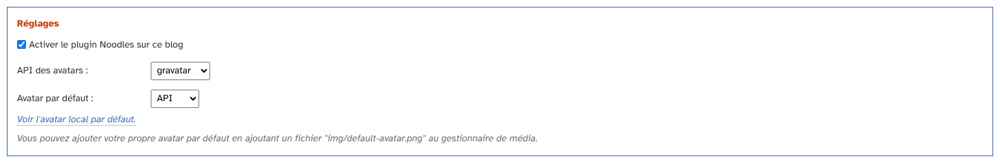
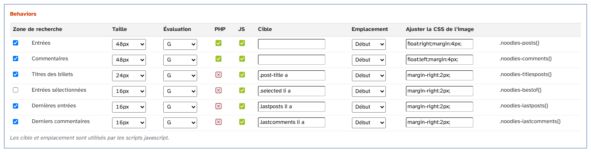
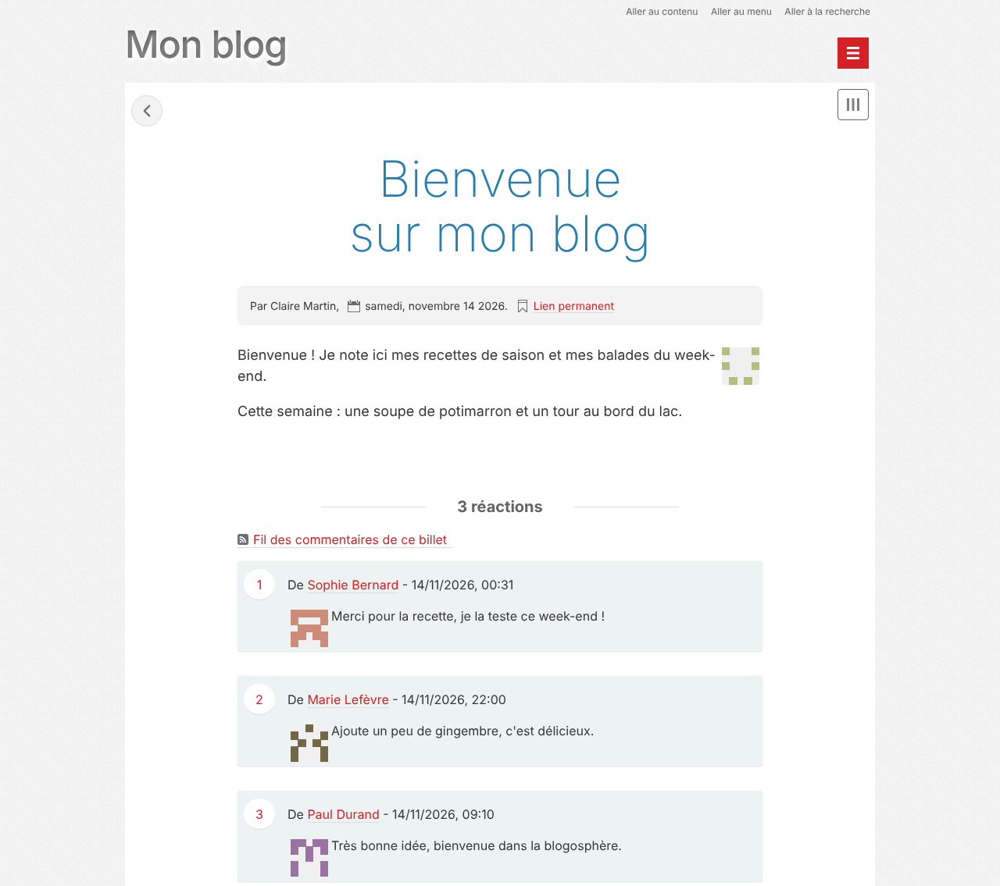
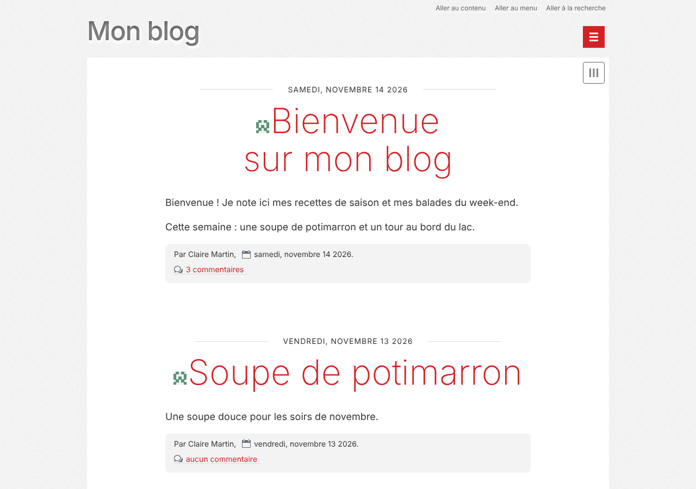
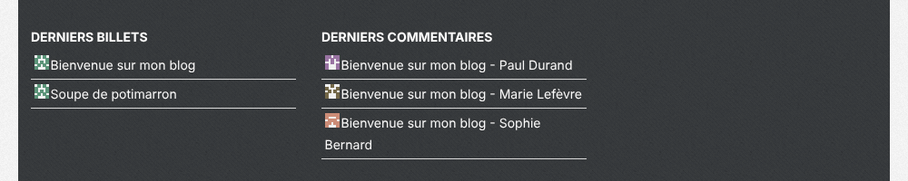

# Noodles : guide d'utilisation

Noodles ajoute des avatars « Gravatar » sur votre blog : à côté du nom d'un auteur, d'un commentaire, d'un titre de billet ou d'un lien des widgets.
Gravatar associe une image à une adresse e-mail.
Noodles retrouve l'adresse e-mail de l'auteur ou du commentateur et affiche son image.

## Sommaire

* [Avant de commencer](#avant-de-commencer)
* [Activer Noodles](#activer-noodles)
* [Choisir les endroits](#choisir-les-endroits)
* [Les avatars sur le blog](#les-avatars-sur-le-blog)
* [Régler la taille, l'évaluation et le style](#régler-la-taille-lévaluation-et-le-style)
* [Les avatars dans les widgets et les titres](#les-avatars-dans-les-widgets-et-les-titres)
* [Choisir l'avatar par défaut](#choisir-lavatar-par-défaut)
* [Ce qu'il faut savoir](#ce-quil-faut-savoir)

## Avant de commencer

Ouvrez le menu « Plugins », puis « Noodles ».
Le menu est réservé aux administrateurs et aux utilisateurs qui peuvent « gérer toutes les entrées et commentaires ».

La page contient deux blocs : « Réglages » pour le fonctionnement général, et « Behaviors » (les endroits où afficher des avatars).

## Activer Noodles

Au départ, Noodles est désactivé.
Dans le bloc « Réglages », cochez « Activer le plugin Noodles sur ce blog ».

Deux autres réglages se trouvent dans ce bloc :

* **API des avatars** : le service qui fournit les images, « gravatar » ou « libravatar » ;
* **Avatar par défaut** : « API » ou « Locale », voir plus bas.

Cliquez sur « Enregistrer (s) » en bas de la page.
La page affiche un message de confirmation, en anglais : « Configuration successfully updated ».

## Choisir les endroits

Le bloc « Behaviors » liste les endroits où Noodles peut ajouter un avatar.
Cochez la case de chaque endroit voulu.

| Zone de recherche | Où apparaît l'avatar |
|---|---|
| Entrées | à côté du contenu d'un billet, avec l'avatar de son auteur |
| Commentaires | à côté de chaque commentaire, avec l'avatar de la personne qui l'a écrit |
| Titres des billets | devant le titre de chaque billet |
| Entrées sélectionnées | devant chaque lien du widget « Entrées sélectionnées » |
| Dernières entrées | devant chaque lien du widget « Dernières entrées » |
| Derniers commentaires | devant chaque lien du widget « Derniers commentaires » |

Si les plugins correspondants sont installés et actifs, la liste propose aussi les widgets des auteurs, les billets les mieux notés et les dernières entrées étendues.

Au départ, seuls « Commentaires » et « Derniers commentaires » sont cochés.

## Les avatars sur le blog

Voici un billet avec les avatars « Entrées » (à droite du texte) et « Commentaires » (à gauche de chaque commentaire).
Les images de ces captures sont des exemples : chez vous, Gravatar affiche l'image associée à chaque adresse e-mail.

Les avatars « Entrées » et « Commentaires » n'apparaissent que sur la page d'un billet.
Ils utilisent l'adresse e-mail de l'auteur du billet et celle que le commentateur a saisie dans le formulaire.

## Régler la taille, l'évaluation et le style

Chaque ligne du bloc « Behaviors » a ses propres réglages.

* **Taille** : de 16 à 256 pixels.
* **Évaluation** : le niveau de public de l'image demandé à Gravatar : G (tous publics), PG, R ou X. Le choix « G » est le plus prudent.
* **Ajuster la CSS de l'image** : des règles de style écrites directement, par exemple `float:left;margin:4px;` pour placer l'image à gauche avec une marge. La dernière colonne rappelle la classe de l'image, par exemple `.noodles-comments{}`, que vous pouvez aussi utiliser dans la feuille de style de votre thème.
* **Emplacement** : pour « Entrées » et « Commentaires », « Début » et « Avant » placent l'avatar avant le contenu, « Fin » et « Après » le placent après.

La colonne « PHP » indique la façon dont l'avatar est ajouté : par le blog lui-même (coche verte), ou par un petit script dans la page (croix rouge).

## Les avatars dans les widgets et les titres

Pour les titres des billets et les widgets, l'avatar est ajouté par un script, devant ou derrière un lien de la page.
Deux réglages de la ligne décident où :

* **Cible** : l'élément de la page à repérer, écrit comme un sélecteur CSS. Par exemple `.lastposts li a` désigne les liens du widget « Dernières entrées ». Les valeurs d'origine fonctionnent avec le thème Berlin ;
* **Emplacement** : « Début » met l'avatar au début du lien, « Fin » à la fin, « Avant » juste avant le lien, « Après » juste après.

Si votre thème n'utilise pas les mêmes classes, changez la cible pour qu'elle corresponde.

Voici la page d'accueil avec les avatars devant les titres des billets, et le bas de page avec les widgets « Dernières entrées » et « Derniers commentaires » :

Les widgets doivent d'abord être ajoutés à un volet, dans le menu « Widgets » : Noodles ne les crée pas.

## Choisir l'avatar par défaut

Quand une adresse e-mail n'a pas d'image chez Gravatar, un avatar par défaut s'affiche.
Le réglage « Avatar par défaut » en décide :

* « API » : l'image par défaut du service choisi ;
* « Locale » : une image de votre blog.

Le lien « Voir l'avatar local par défaut » sous les réglages ouvre l'image qui sera utilisée.

Pour utiliser votre propre image, envoyez un fichier nommé `default-avatar.png` à la racine de votre médiathèque (le dossier principal, pas un sous-dossier), ou dans le dossier `img` du thème.
Noodles cherche d'abord dans le dossier `img` du thème, puis à la racine de la médiathèque, puis utilise l'image fournie avec le plugin.

## Ce qu'il faut savoir

* Les images viennent d'un service extérieur. L'adresse e-mail n'est pas envoyée en clair : le blog envoie une empreinte, c'est-à-dire un code calculé à partir de l'adresse.
* Pour « Entrées » et « Commentaires », les images viennent toujours de Gravatar, même si vous choisissez « libravatar ». Le choix de l'API ne concerne que les autres lignes.
* Chaque blog a ses propres réglages.
